<a href="https://d3vo.ru"><b>d3vo.ru</b></a> · <a href="https://t.me/contactfiuimwix_bot">telegram</a> · <a href="https://wakatime.com/@xdearboy">wakatime</a> · <a href="https://www.codewars.com/users/xdearboy">codewars</a> · <a href="https://github.com/xdearboy/dotfiles">dotfiles</a>

cards are generated by <a href="scripts/build.mjs">scripts/build.mjs</a> and refreshed every 6 hours · palette and font from <a href="https://d3vo.ru">d3vo.ru</a>

